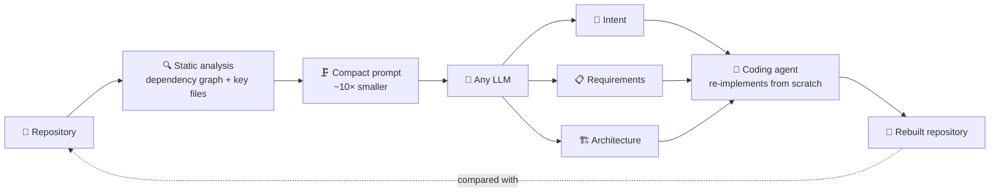

<div align="center">

# 🚢 code-theseus

**Recover the design behind any codebase, so coding agents can plan before they code.**

[](pyproject.toml)
[](LICENSE)

| 📦 **10,764** | 🌐 **4** | 📉 **~10×** | 🧱 **+17%** |
|:---:|:---:|:---:|:---:|
| repositories processed | languages: Java, Python, C/C++, C# | fewer tokens than raw source | closer module structure when agents rebuild from the docs |

📄 *The Code of Theseus: Can Agents Rebuild Software from Recovered Design Documents?*

</div>

## 🧭 Why

Coding agents increasingly design before they code: one agent writes
requirements, another the architecture, a third the implementation. But
almost no data exists to train or evaluate those early steps. Real projects
rarely keep design documents, and when they do they are outdated or private.

**Source code is everywhere. code-theseus turns it back into the design.**

## 🧩 How it works



| | Output | What it captures |
|---|---|---|
| 🎯 | **Stakeholder intent** | The "initial prompt": what the system is for and who it serves |
| 📋 | **Requirements** | Functional and non-functional requirements, traceable to the intent |
| 🏗️ | **Architecture** | A C4 model of containers, components and their relationships |

**Agentic re-implementation.** The documents are then handed to an
autonomous coding agent (OpenHands), which rebuilds the software from
scratch in a sandboxed Docker environment. Comparing the rebuilt repository
with the original shows how much of the design the documents carry, in
behaviour (held-out tests) and in structure (module layout).

**Why static analysis, not "paste the repo into the LLM"?**

- 💸 **~10× cheaper.** A 2.1M-token codebase like Tesseract becomes an
  88K-token prompt, so whole portfolios fit the budget, not just a pilot.
- 🔁 **Deterministic.** The same repository always yields the same prompt:
  no agent crawling, no context splitting, fewer hallucinations.
- 🤖 **Model-agnostic.** Hosted APIs through LiteLLM, or open-weight models
  (Gemma, Qwen, Mistral, GPT-OSS, …) self-hosted on vLLM, with concurrent and
  resumable batch runs.

## 🔁 Does it work? The Ship of Theseus test

If an agent rebuilds a library from the design recovered from its own code,
is it the same system? We ran the re-implementation loop on real Python
libraries from [Commit0](https://github.com/commit-0/commit0), with and
without the recovered documents:

- ✅ **Good documentation.** An LLM judge rates the documents clear and
  consistent across generator models.
- 🧱 **Better structure.** With the documents, the agent builds a module
  structure significantly closer to the original (module F1 0.54 → 0.63,
  closer on 17 of 24 libraries). This is what tests can't specify and what
  teams maintain.
- ⚖️ **Same behaviour.** Held-out test pass rates stay about the same. The
  documents carry the plan, not the planks.

## 🏢 Use cases

- **Spec-driven coding agents.** Hand agents a requirements and architecture
  brief instead of a one-line prompt.
- **Legacy modernisation and onboarding.** Recover design documentation for
  systems that never had any.
- **Fine-tuning and evaluation data.** Code ↔ intent ↔ requirements ↔
  architecture pairs for training models that design before they implement,
  and for benchmarking the intermediate steps of multi-agent development.

## 🗂️ Repository layout

| Path | What's there |
|---|---|
| `src/reverse_se/` | Python package: `graph/` (dependency-graph loading), `generation/` (LLM document generation), `evaluation/` (judges, coverage, stats), `benchmark/` (Commit0 agent benchmark) |
| `scripts/` | Dataset-build pipeline and analysis scripts (Python, Bash, R) — see [scripts/README.md](scripts/README.md) |
| `prompts/` | Jinja templates for generation and judging — see [prompts/README.md](prompts/README.md) |
| `collect-kit/` | Self-contained Docker kit to collect data from a single repository — see [collect-kit/README.md](collect-kit/README.md) |
| `docker/`, `compose.yaml`, `Dockerfile` | Containers for vLLM serving, PDF rendering, code counting and the benchmark |
| `tools/arcan/` | Arcan configuration |
| `notebooks/`, `figures/` | Exploration notebooks and generated plots |

## ⚙️ Setup

Requires [uv](https://docs.astral.sh/uv/) and Docker.

```sh
uv sync                        # add --extra local-inference to run models with transformers / llama.cpp
cp .env.example .env           # GitHub token + LLM provider keys
docker pull ghcr.io/arcan-tech/arcan-2-cli-trial:latest   # Arcan static analysis (--platform linux/amd64 on Apple Silicon)
```

Optional containers in `compose.yaml`:

- **vLLM** to serve open-weight models locally, e.g. `docker compose --profile qwen up`.
- **benchmark** to run the Commit0 agent benchmark in Docker (step 4 below):
  `docker compose --profile benchmark build`.
- **md2pdf** (`docker/md2pdf`) for `make pdf-docs`.

## 🛠️ Usage

Four stages, each usable on its own. `make help` lists all targets.

**1. Build the dataset.** Collect URLs → dedupe → fetch GitHub metadata →
filter → clone → Arcan → scan context files → combine into a dataset JSONL:

```sh
make pipeline                                         # or one stage: make filter, make arcan, …
make arcan TSV=data/raw/filter_100_2022_list.tsv      # override paths per stage
```

`BUDGET_GB=150 TOKEN_GB=8` throttles Arcan by memory on shared hosts. Each
stage's inputs and outputs are in [scripts/README.md](scripts/README.md);
for a single repository, use [collect-kit](collect-kit/README.md).

**2. Generate documents** with any LiteLLM model (`hosted_vllm/…`,
`openai/…`, `deepseek/…`), or locally with `inference_transformers`:

```sh
uv run python -m reverse_se.generation.inference_litellm \
    --dataset data/out/<dataset>.jsonl \
    --model hosted_vllm/<model> --api_base http://localhost:8000/v1 \
    --tasks intent req c4 --context_budget ctx95
```

Outputs go to `data/out/llm_results/<model>/<context_budget>/<task>/<repo_id>.json`.
`make render-prompts DATASET=...` dumps prompts without calling a model;
`make pdf-docs` renders the C4 docs to PDF.

**3. Evaluate** with rubric scoring and intent → requirements → architecture
alignment (also `doc_coverage`, `doc_stats`, `semantic_voting`; see each
module's `--help`):

```sh
uv run python -m reverse_se.evaluation.llm_as_judge \
    --dataset data/out/<dataset>.jsonl --results_dir data/out/llm_results \
    --task c4 --judge_model <model> --output data/out/judge/<scores>.jsonl
uv run python -m reverse_se.evaluation.alignment_judge run \
    --dataset data/out/<dataset>.jsonl --output data/out/judge/alignment/<scores>.jsonl
```

**4. Run the Commit0 benchmark.** A coding agent rebuilds each library with
intent alone vs. with the generated requirements and architecture. Needs
Docker and a model endpoint:

```sh
uv run scripts/python/commit0_list.py
./scripts/bash/prefetch_commit0.sh data/raw/commit0/commit0_instances.jsonl
# ... build the dataset and generate docs for data/raw/commit0 (steps 1–2)
uv run scripts/python/benchmark_commit0.py prepare --lite
uv run scripts/python/benchmark_commit0.py run --lite \
    --docs-dir data/out/llm_results/<doc-model>/ctx95 \
    --model hosted_vllm/<model> --api_base http://<vllm-service>:8000/v1 \
    --replicates 3
```

To run inside Docker, prefix the `benchmark_commit0.py` commands with
`docker compose --profile benchmark run --rm benchmark`. Scaffold levels and
grading are covered in [scripts/README.md](scripts/README.md).

## 📜 License

MIT. See [LICENSE](LICENSE).
